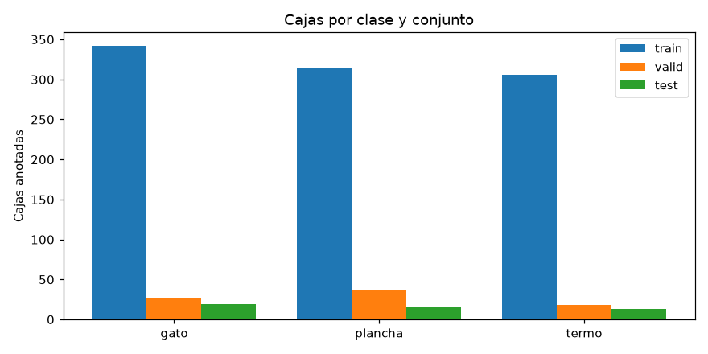
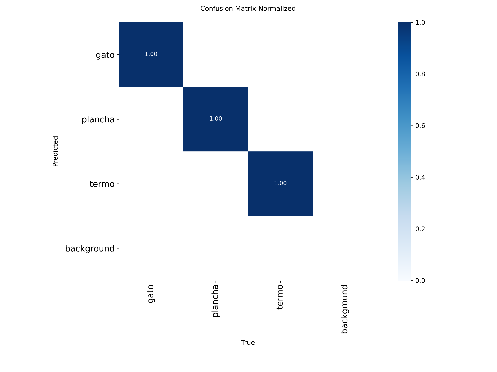
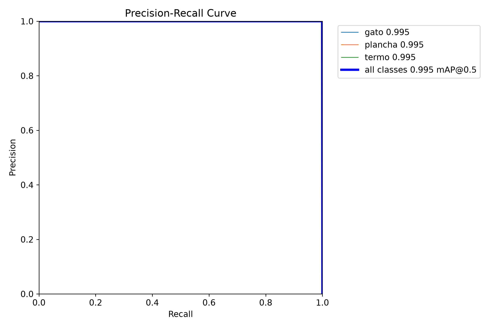
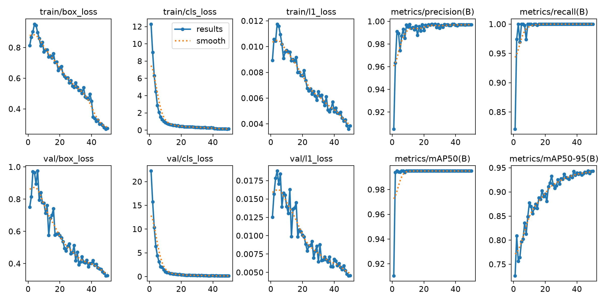
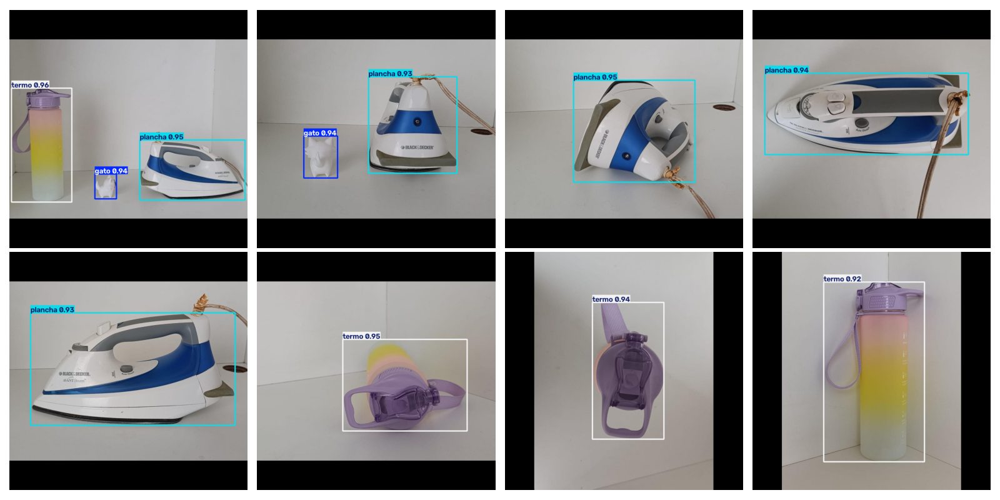
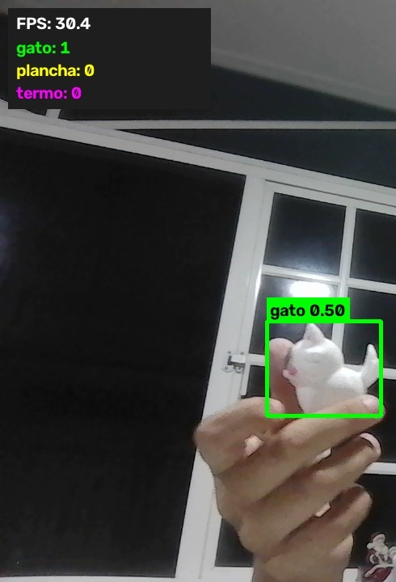

# Detector personalizado de objetos con YOLO26 y Roboflow

Detector de objetos entrenado con un dataset propio. Reconoce tres objetos cotidianos que el modelo preentrenado no conoce, y funciona en tiempo real con la webcam.

| Clase | Objeto |
|---|---|
| `gato` | Figura de un gato blanco, pequeña |
| `plancha` | Plancha de ropa blanca y azul |
| `termo` | Botella de agua morada con degradado rosa, amarillo y blanco |

Se parte de **YOLO26 nano** preentrenado en COCO y se ajusta (*fine-tuning*) con las fotos propias, anotadas en **Roboflow**.

## Cómo funciona

1. **Captura.** Las fotos se toman con la misma webcam que usa el detector (`src/capture.py`) y con el celular, cambiando ángulo, distancia, fondo y luz. Así las imágenes de entrenamiento se parecen a las que el modelo verá al usarlo.
2. **Anotación.** Las fotos se suben a Roboflow, se anotan con cajas (*bounding boxes*) y se genera una versión del dataset con sus conjuntos de entrenamiento, validación y prueba.
3. **Entrenamiento.** El notebook descarga el dataset con la API de Roboflow y entrena YOLO26 durante 50 épocas con imágenes de 960 x 960, con parada anticipada si el modelo deja de mejorar.
4. **Evaluación.** Se mide el modelo sobre imágenes que no usó para entrenar con precisión, recall, mAP50 y mAP50-95, por clase y en global, y se generan la matriz de confusión y la curva precisión-recall.
5. **Detección en tiempo real.** `src/detect_webcam.py` abre la webcam y dibuja en cada cuadro las cajas con su clase y confianza, un contador por clase y los cuadros por segundo.

## Dataset

Las 431 fotos originales están en `data/para_subir/`, todas en una carpeta. El nombre de cada archivo indica el origen y el objeto, por ejemplo `webcam_termo_001.jpg` o `celu_plancha_012.jpg`.

| Objeto | Webcam | Celular | Total | Contenido |
|---|---|---|---|---|
| `gato` | 111 | 0 | 111 | La figura sola, en la mano y sobre superficies, cerca y lejos |
| `plancha` | 79 | 28 | 107 | La plancha desde varios ángulos, fondos y luces |
| `termo` | 62 | 27 | 89 | El termo acostado y de pie, con fondos y luces distintos |
| `juntos` | 38 | 12 | 50 | Los tres objetos en la misma escena |
| `fondo` | 74 | 0 | 74 | Escenas sin ningún objeto, sin cajas, para enseñar lo que no es un objeto |
| **Total** | 364 | 67 | 431 | |

Las fotos de `juntos` enseñan al modelo a separar los objetos cuando aparecen a la vez, y las de `fondo` reducen las detecciones falsas.

Por privacidad, las 104 fotos donde aparece el rostro del autor, o parte de este, no se publican en este repositorio. Forman parte del dataset completo, que está en Roboflow, y las cifras de esta página corresponden a ese dataset completo.

### Versión del dataset en Roboflow

El proyecto `objetos-webcam` tiene la versión 2 con 992 imágenes:

- **Reparto:** 70 % entrenamiento, 20 % validación y 10 % prueba sobre las fotos originales (*Rebalance Splits*).
- **Preprocesamiento:** orientación automática y redimensionado a 960 x 960 con bordes negros, sin deformar los objetos.
- **Aumento de datos:** exposición de -15 % a +15 %, con 3 salidas por cada imagen de entrenamiento.

Roboflow muestra 88 % / 8 % / 4 % porque las copias aumentadas solo se agregan al conjunto de entrenamiento; las fotos originales sí se repartieron 70 / 20 / 10.

| Conjunto | Imágenes | `gato` | `plancha` | `termo` |
|---|---|---|---|---|
| Entrenamiento | 868 | 342 cajas | 315 cajas | 306 cajas |
| Validación | 83 | 27 cajas | 36 cajas | 18 cajas |
| Prueba | 41 | 19 cajas | 15 cajas | 13 cajas |



## Resultados

El modelo se entrenó durante 50 épocas con YOLO26 nano, imágenes de 960 x 960 y lotes de 8, en una GPU NVIDIA RTX 4060. Las métricas se midieron sobre las 41 imágenes de prueba, que el modelo no vio al entrenar.

| Clase | Precisión | Recall | mAP50 | mAP50-95 |
|---|---|---|---|---|
| Global | 0.996 | 1.000 | 0.995 | 0.935 |
| `gato` | 1.000 | 1.000 | 0.995 | 0.891 |
| `plancha` | 0.995 | 1.000 | 0.995 | 0.933 |
| `termo` | 0.994 | 1.000 | 0.995 | 0.981 |

Con la confianza de uso normal (0.25), la matriz de confusión queda con la diagonal completa: todos los objetos de las imágenes de prueba se reconocen con su clase correcta.







Detecciones del modelo sobre imágenes de prueba, con los tres objetos juntos y por separado:



Las fotos de entrenamiento y de prueba salen de las mismas sesiones de captura, por lo que se parecen entre sí y las métricas resultan altas. La prueba más exigente es la detección en tiempo real con la webcam, que trabaja con imágenes completamente nuevas.

### Detección en tiempo real

Con la webcam y la GPU, el modelo detecta a unos 30 cuadros por segundo, que es lo que entrega la cámara. Cada cuadro muestra las cajas con su clase y confianza, y el panel con el contador por clase y los cuadros por segundo. La tecla **S** guarda una captura en `reports/`.



## Estructura del proyecto

```
data/
    para_subir/                      Fotos originales que se suben a Roboflow
notebooks/
    deteccion_personalizada_yolo.ipynb   Dataset, entrenamiento, evaluación y webcam
src/
    capture.py                       Toma fotos con la webcam
    extract_frames.py                Extrae cuadros útiles de un video
    detect_webcam.py                 Detección en tiempo real con la webcam
reports/                             Gráficas y resumen que genera el notebook
.env.example                         Plantilla de la configuración de Roboflow
requirements.txt                     Dependencias de Python
README.md                            Este archivo
```

El dataset anotado se descarga de Roboflow a `datasets/` y los resultados del entrenamiento quedan en `runs/`. Ambas carpetas se regeneran al ejecutar el notebook, por eso no se suben a GitHub, igual que los modelos `.pt` y el archivo `.env`.

## Requisitos

- Windows con Python 3.10 o superior (se desarrolló con Python 3.12)
- Una webcam, para la detección en tiempo real
- Una cuenta gratuita de Roboflow con el proyecto del dataset
- Una GPU NVIDIA para entrenar con imágenes de 960 x 960 (se usó una RTX 4060 de 8 GB)
- Las librerías de `requirements.txt`: Ultralytics, OpenCV, Roboflow, python-dotenv, NumPy, Matplotlib, Pillow, Jupyter, ipykernel, nbformat y nbconvert

El modelo base `yolo26n.pt` (unos 5 MB) lo descarga Ultralytics solo la primera vez.

## Cómo ejecutarlo

Todos los comandos son para PowerShell de Windows. La webcam no funciona desde WSL, por eso se usa Python de Windows.

### 1. Clonar el repositorio

```powershell
git clone https://github.com/DanielSozoranga/vision-computadora-yolo-personalizado.git
cd vision-computadora-yolo-personalizado
```

### 2. Crear el entorno e instalar las dependencias

```powershell
py -m venv vision-yolo-pers
.\vision-yolo-pers\Scripts\python.exe -m pip install torch torchvision --index-url https://download.pytorch.org/whl/cu126
.\vision-yolo-pers\Scripts\python.exe -m pip install -r requirements.txt
```

PyTorch se instala primero en su versión con CUDA 12.6 para usar la GPU. Para comprobar que todo quedó bien y que la GPU está disponible:

```powershell
.\vision-yolo-pers\Scripts\python.exe -c "import torch, ultralytics, cv2, roboflow; print('GPU:', torch.cuda.is_available())"
```

Sin GPU también funciona: instala PyTorch desde `https://download.pytorch.org/whl/cpu` y baja `IMGSZ` en el notebook, aunque el entrenamiento tardará bastante más.

### 3. Configurar Roboflow

Copia `.env.example` como `.env` y completa tu clave API. La clave se obtiene en Roboflow, en Settings y luego API Keys. Los demás datos (`ROBOFLOW_PROJECT=objetos-webcam` y `ROBOFLOW_VERSION=2`) ya vienen en la plantilla. El archivo `.env` está en el `.gitignore` y no se sube nunca.

```powershell
copy .env.example .env
```

### 4. Entrenar y evaluar

Registra el entorno como kernel de Jupyter y abre el notebook:

```powershell
.\vision-yolo-pers\Scripts\python.exe -m ipykernel install --user --name vision-yolo-pers --display-name "Python (vision-yolo-pers)"
.\vision-yolo-pers\Scripts\jupyter.exe lab notebooks\deteccion_personalizada_yolo.ipynb
```

Elige el kernel `Python (vision-yolo-pers)` y ejecuta las celdas en orden. Al terminar, el notebook guarda en `reports/` las gráficas del entrenamiento, la matriz de confusión, la curva precisión-recall, las pruebas sobre imágenes y un resumen en `resumen.json`.

### 5. Detección en tiempo real

Una vez entrenado el modelo, se puede usar directamente desde la terminal:

```powershell
.\vision-yolo-pers\Scripts\python.exe src\detect_webcam.py
```

Opciones: `--conf 0.5` cambia la confianza mínima, `--camara 1` usa otra cámara y `--modelo ruta\best.pt` usa otro modelo. En la ventana, la tecla **S** guarda una captura en `reports/` y la tecla **Q** sale.

## Crear un dataset propio

1. Toma fotos de cada objeto con la webcam, cambiando el ángulo, la distancia, el fondo y la luz:

```powershell
.\vision-yolo-pers\Scripts\python.exe src\capture.py --clase gato --carpeta fotos_webcam --auto --meta 50
```

   Usa la clase `fondo` para escenas sin ningún objeto y `juntos` para varios objetos a la vez.

2. También se pueden extraer fotos de un video, con `src/extract_frames.py`, que descarta los cuadros borrosos y los muy parecidos entre sí:

```powershell
.\vision-yolo-pers\Scripts\python.exe src\extract_frames.py data\videos\termo.mp4 --clase termo --max 20
```

3. Sube las fotos a un proyecto de **Object Detection** en Roboflow, crea las clases, anota todos los objetos de cada imagen, agrega las imágenes al dataset, reparte los conjuntos con *Rebalance Splits* y genera una versión.
4. Actualiza `ROBOFLOW_PROJECT` y `ROBOFLOW_VERSION` en `.env` y ejecuta el notebook.

## Cumplimiento de la rúbrica

| Criterio | Puntos | Dónde se cumple |
|---|---|---|
| 1. Creación del dataset | 4 | Dataset propio de 431 fotos originales (992 imágenes con aumento de datos) con tres clases, anotado en Roboflow, descrito en el notebook con imágenes y cajas por clase |
| 2. Entrenamiento | 1 | YOLO26 con fine-tuning, 50 épocas, tamaño 960, lote 8 y parada anticipada |
| 3. Evaluación | 1 | Precisión, recall, mAP50 y mAP50-95 por clase y global, con matriz de confusión y análisis generado a partir de las métricas |
| 4. Detección personalizada | 3 | Detección en tiempo real con la webcam, con cajas, contador por clase y cuadros por segundo |
| 5. Documentación | 1 | Este README y el notebook, que explican el proceso, el dataset y el rendimiento |
